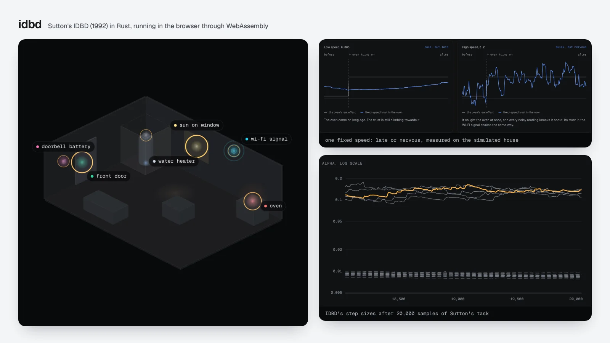
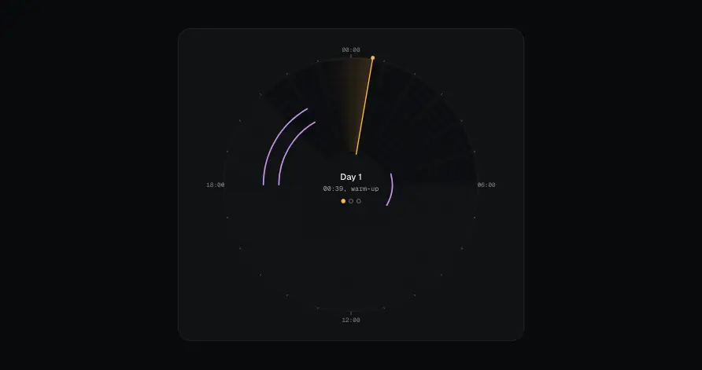

# idbd

<p align="center">
  <a href="https://github.com/minikin/idbd/actions/workflows/ci.yml"></a>
  <a href="https://github.com/minikin/idbd/actions/workflows/ci.yml"></a>
  <a href="scripts/coverage.sh"></a>
  <a href="crates/idbd/Cargo.toml"></a>
  <a href="#license"></a>
</p>

<p align="center">
  <picture>
    <source media="(prefers-color-scheme: dark)" srcset="docs/assets/hero-dark.webp">
    
  </picture>
</p>

IDBD (Sutton, 1992) is the LMS rule with one learning rate per input. It keeps
`beta_i = ln(alpha_i)` for every input and moves it by gradient descent on the squared error,
so an input whose corrections keep pointing the same way gets a larger step and an input whose
corrections cancel out gets a smaller one. No input is marked as relevant in advance.

This repository has three parts:

- `idbd`, the crate: IDBD and Autostep (Mahmood et al., 2012) as checked, atomic,
  allocation-free online learners. No dependencies, no `unsafe`, Rust 1.85 or newer.
- `idbd-lab`: an approximate reproduction of the paper's two experiments, plus new tasks, with
  every result below produced from recorded seeds.
- A browser demo that runs the same Rust through WebAssembly: a story page for people who have
  never trained a model, and an Explorer for those who have.

| Path | Contents |
| --- | --- |
| [`crates/idbd`](crates/idbd) | The library. |
| [`crates/idbd-lab`](crates/idbd-lab) | Unpublished. Seeded tasks, an LMS baseline, experiment and benchmark binaries. |
| [`crates/idbd-wasm`](crates/idbd-wasm) | Unpublished. The `wasm-bindgen` adapter used by the demo. |
| [`web`](web) | The story page and the Explorer, static, with Playwright tests. |
| [`docs`](docs) | Reproduction instructions, generated results and benchmarks. |
| [`features/idbd.feature`](features/idbd.feature) | The behavior specification: 61 scenarios in 13 rules. |

## Using the crate

```toml
[dependencies]
idbd = "0.1"
```

```rust
use idbd::{Config, Idbd};

fn main() -> Result<(), Box<dyn std::error::Error>> {
    // Initial step size 0.05, meta step size theta 0.01.
    let mut learner = Idbd::new(3, Config::new(0.05, 0.01)?)?;
    let report = learner.update(&[0.5, -1.0, 1.0], 2.0)?;
    println!("error before learning: {}", report.error);
    Ok(())
}
```

`update` predicts, measures the error, adapts the step sizes and then the weights, in Sutton's
order. A failed update returns a typed error and leaves the learner bit for bit as it was. The
learning path does not allocate.

[`examples/latency.rs`](crates/idbd/examples/latency.rs) is a complete streaming application:
input and target scaling, predicting before learning, skipping an invalid sample, and
checkpointing the learner with its stream position. Run it with
`cargo run -p idbd --example latency`. The [crate README](crates/idbd/README.md) covers the
update equations, configuration, bounds, checkpoints, when to use IDBD and its limitations.

## The demo

<p align="center">
  
</p>

The story page explains IDBD with a thermostat house. Six sensors, three of which move the room
temperature by amounts that keep switching. The page walks through one update in slow motion,
plots a fixed learning speed that is late or nervous when the oven switches on, and ends with a
game in which you set the trust in each sensor by hand and race IDBD and a tuned fixed-speed
learner. Every learning value on the page comes from the crate. In a house where nothing
switches, the tuned fixed speed wins, and the page says so.

The Explorer runs IDBD, LMS and untuned Autostep side by side on Sutton's 20-input task, with
replay, export and a guided single update.

```sh
just web-serve   # build, then serve the story at http://127.0.0.1:8173 and /explorer.html
```

## Results

Every number below was produced by the binaries in `crates/idbd-lab` with recorded seeds. The
paper's random draws are unpublished, so these are approximate replications. Each results page
lists the protocol differences.

**Experiment 1 (Figure 3).** 20 inputs, 5 relevant, one sign flip every 20 samples, 20,000
warm-up and 10,000 measured samples, 20 seeds, no bounds. Mean squared error with one standard
error:

| Learner | Best parameter in our grid | MSE | Sutton (1992) |
| --- | --- | --- | --- |
| LMS | alpha 0.03 | 3.402 +/- 0.017 | about 3.5 |
| IDBD, initial alpha 0.05 | theta 0.015 | 1.525 +/- 0.007 | about 1.5 |

At theta 0.02, 5 of 20 IDBD runs failed with a step-size overflow. LMS diverged at alpha 0.09
and above. [Details and plot](docs/results/sutton1992-experiment1/README.md).

**Experiment 2 (Figures 4 and 5).** theta 0.001, 250,000 samples, 5 seeds. The relevant inputs'
step sizes end at 0.129 on average (paper: 0.13 +/- 0.015). The irrelevant inputs end between
0.0073 and 0.0078, slightly above the paper's "all below 0.007". A fixed-rate sweep over the
relevant inputs has its minimum at alpha 0.13 to 0.14 (paper: 0.13 +/- 0.01).
[Details and plots](docs/results/sutton1992-experiment2/README.md).

**Evaluation against LMS (new tasks).** LMS alpha and IDBD theta were each chosen on tuning
seeds 1001 to 1005, then evaluated on seeds 1 to 10:

| Task | LMS MSE | IDBD MSE |
| --- | --- | --- |
| Sutton 1992 task | 3.422 +/- 0.021 | 1.516 +/- 0.010 |
| Drifting coefficients (extension) | 0.219 +/- 0.002 | 0.110 +/- 0.001 |
| Changing relevance (extension) | 3.428 +/- 0.027 | 2.519 +/- 0.024 |
| Stationary | both below 1e-38 | both below 1e-38 |

These are noise-free synthetic tasks where a few inputs matter and the relationship changes.
They do not show that IDBD beats a tuned LMS in general. [Method and per-seed
results](docs/results/evaluation/README.md).

**Autostep (new tasks, same protocol).** Autostep (Mahmood et al., 2012) at the paper's
default mu = 0.01, with no tuning, against the tuned learners above:

| Task | Autostep, default mu | Autostep, mu tuned |
| --- | --- | --- |
| Sutton 1992 task | 2.267 +/- 0.016 | 2.052 +/- 0.027 (mu 0.1) |
| Drifting coefficients (extension) | 0.185 +/- 0.004 | 0.132 +/- 0.003 (mu 0.1) |
| Changing relevance (extension) | 4.022 +/- 0.028 | 3.448 +/- 0.032 (mu 0.03) |
| Stationary | below 1e-30 | below 1e-32 |

On these tasks untuned Autostep beat tuned LMS on two of three nonstationary tasks and trailed
tuned IDBD on all of them. At mu = 1, 19 of 20 tuning runs stopped when a step size underflowed
to zero. [Method, mu sweep and step sizes](docs/results/autostep/README.md).

**The thermostat house (new task, same protocol).** Six sensors with noisy readings, three
of which switch between a strong and a weak influence on the room temperature. This is the
task behind the story page. The noise alone gives an MSE of 0.25.

| Task | LMS, tuned | IDBD, tuned | Autostep, default |
| --- | --- | --- | --- |
| House, influences switch | 0.630 +/- 0.003 | 0.543 +/- 0.004 | 0.587 +/- 0.004 |
| Same house, nothing switches | 0.252 +/- 0.001 | 0.269 +/- 0.001 | 0.262 +/- 0.001 |

IDBD was lower than tuned LMS on all 10 seeds of the switching house and on none of the still
house. Its final step sizes were 0.079 to 0.137 on the three sensors that matter and about 0.012
on the other three. [Method and per-sensor step sizes](docs/results/house/README.md).

**Performance.** On an Apple M4 Max, one IDBD update with 20 features takes about 95 ns and costs
about 5 ns per feature up to 10,000 features. One `exp` call per input accounts for an estimated
85 to 97% of that, so SIMD has little to gain. An Autostep update costs about 2.4 to 2.7 times an
IDBD update. [Method and full table](docs/benchmarks.md).

## Reproducing the results

```sh
cargo run --release -p idbd-lab --bin sutton1992-exp1   # Experiment 1, about 3 s (see docs/reproduction.md)
cargo run --release -p idbd-lab --bin sutton1992-exp2   # Experiment 2 and the Figure 5 sweep
cargo run --release -p idbd-lab --bin evaluate          # IDBD against LMS on four tasks
cargo run --release -p idbd-lab --bin house-eval        # the thermostat house
cargo run --release -p idbd-lab --bin bench             # core timings
```

Each binary writes CSV, SVG and Markdown under `docs/results` (or `--out <dir>`). Reruns on the
same build and platform reproduce the files byte for byte. [docs/reproduction.md](docs/reproduction.md)
lists the generator, seeds, grids and sign-flip timing.

## Building the demo

```sh
just web-setup   # once: install Playwright with Chromium, Firefox and WebKit
just web-test    # rebuild, then run the Playwright tests in all three browsers
just readme-assets   # re-render the README images from the demo
```

The build needs the `wasm32-unknown-unknown` target, `wasm-bindgen-cli` 0.2.113 (the version
pinned in `crates/idbd-wasm`) and Node.js. The house is drawn with three.js 0.170.0, pinned in
`web/package.json`, and in 2D when WebGL is missing or the visitor prefers reduced motion. The
site is static: after `just web-build`, any file server that sends `.wasm` as
`application/wasm` can host `web/`.

The `Demo` workflow deploys to GitHub Pages. It copies only `index.html`, `explorer.html`,
`styles.css`, `src/`, `story/`, three.js from `vendor/` and the two files the pages load from
`pkg/`. It deploys on every push to `main` once the repository variable `DEPLOY_DEMO` is
`true`, and on any manual run. GitHub Pages must be enabled with "GitHub Actions" as the source.

## Development

```sh
cargo fmt --all -- --check
cargo clippy --workspace --all-targets --all-features -- -D warnings
cargo test --workspace --all-features
cargo doc --workspace --no-deps
scripts/coverage.sh                      # coverage and CRAP gates: no function above CRAP 10
cargo mutants -p idbd                    # mutation testing of the core
```

The lint policy follows [BeautifulRust](https://github.com/morganlinton/BeautifulRust). Core
scenario tests carry their IDs from `features/idbd.feature`, for example
`c07_use_old_traces_and_one_shared_pre_update_error`. Numerical fixtures come from an
independent 50-digit decimal implementation in
[`reference.py`](crates/idbd/tests/scenarios/fixtures/reference.py).
[docs/acceptance.md](docs/acceptance.md) maps every scenario to its test or recorded result and
lists what remains open.

## Reference

Richard S. Sutton. *Adapting Bias by Gradient Descent: An Incremental Version of
Delta-Bar-Delta.* In Proceedings of the Tenth National Conference on Artificial Intelligence
(AAAI-92), pages 171-176, 1992. <https://cdn.aaai.org/AAAI/1992/AAAI92-027.pdf>

## License

Licensed under either the [Apache License, Version 2.0](LICENSE-APACHE) or the
[MIT license](LICENSE-MIT), at your option.
