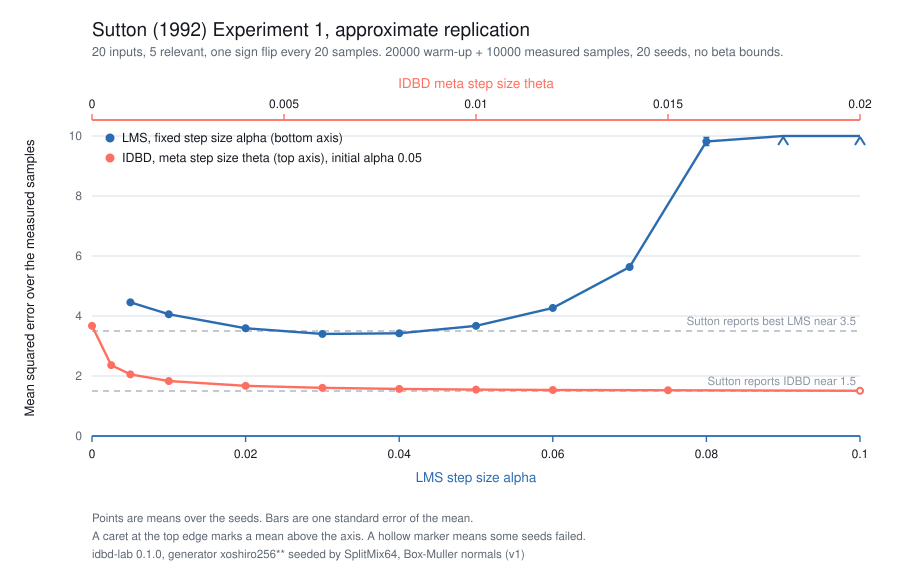

# Sutton 1992, Experiment 1: approximate replication

Scenario E04. Produced by `cargo run --release -p idbd-lab --bin sutton1992-exp1`.

idbd-lab 0.1.0, generator xoshiro256** seeded by SplitMix64, Box-Muller normals (v1)

## Protocol

- Task: the `sutton1992` preset. 20 independent standard normal inputs. The first 5 are relevant with coefficients +1 or -1, drawn from the seed, and the target is their noise-free weighted sum. One of the five, chosen uniformly at random, flips sign before samples 21, 41, 61 and so on, every 20 samples.
- Each run processes 20000 warm-up samples and then 10000 measured samples. The reported error averages the squared pre-update error over the measured samples only.
- Seeds 1..=20, the same streams for every learner at every grid value. A seed fixes the inputs, the initial coefficient signs and which coefficient flips at each boundary.
- IDBD starts every input at step size 0.05 with zero weights and traces, and runs with beta bounds disabled (`Bounds::none()`), as the paper's experiments did.
- LMS alpha grid: 0.005, 0.01, 0.02, 0.03, 0.04, 0.05, 0.06, 0.07, 0.08, 0.09, 0.1.
- IDBD theta grid: 0, 0.0005, 0.001, 0.002, 0.004, 0.006, 0.008, 0.01, 0.012, 0.015, 0.02.

## Measured results

A grid value whose mean exceeds 10, the top of the y axis, is drawn as a caret at the top edge of the plot, with its value in the table below.

LMS, fixed step size:

| alpha | mean MSE | standard error | completed | failed |
| --- | --- | --- | --- | --- |
| 0.005 | 4.456 | 0.01587 | 20 | 0 |
| 0.01 | 4.058 | 0.01323 | 20 | 0 |
| 0.02 | 3.591 | 0.01585 | 20 | 0 |
| 0.03 | 3.402 | 0.01703 | 20 | 0 |
| 0.04 | 3.423 | 0.01784 | 20 | 0 |
| 0.05 | 3.672 | 0.02017 | 20 | 0 |
| 0.06 | 4.268 | 0.02584 | 20 | 0 |
| 0.07 | 5.633 | 0.0411 | 20 | 0 |
| 0.08 | 9.818 | 0.1361 | 20 | 0 |
| 0.09 | 129.693 | 29.817 | 20 | 0 |
| 0.1 | 2.628e186 | inf | 20 | 0 |

IDBD, meta step size:

| theta | mean MSE | standard error | completed | failed |
| --- | --- | --- | --- | --- |
| 0 | 3.672 | 0.02017 | 20 | 0 |
| 0.0005 | 2.362 | 0.01004 | 20 | 0 |
| 0.001 | 2.053 | 0.008359 | 20 | 0 |
| 0.002 | 1.832 | 0.007114 | 20 | 0 |
| 0.004 | 1.672 | 0.006337 | 20 | 0 |
| 0.006 | 1.605 | 0.006162 | 20 | 0 |
| 0.008 | 1.569 | 0.006206 | 20 | 0 |
| 0.01 | 1.547 | 0.006353 | 20 | 0 |
| 0.012 | 1.534 | 0.00658 | 20 | 0 |
| 0.015 | 1.525 | 0.007498 | 20 | 0 |
| 0.02 | 1.508 | 0.008864 | 15 | 5 |

## Best settings

- LMS: alpha 0.03, MSE 3.402 +/- 0.01703.
- IDBD: theta 0.015, MSE 1.525 +/- 0.007498.

Each is the lowest mean over the 20 seeds among grid values whose every run completed. Pairing the two learners seed by seed, IDBD at theta 0.015 is 1.877 +/- 0.01619 lower than LMS at alpha 0.03.

The next best LMS value is alpha 0.04, which is 0.02132 +/- 0.003165 higher per seed.

The next best IDBD value is theta 0.012, which is 0.008597 +/- 0.002528 higher per seed.

The numbers cover one task, one protocol and these grids. They do not say how either learner behaves on other streams, and the grid spacing bounds how precisely the minima are located.

## Comparison with the paper

Sutton reports a best LMS mean squared error near 3.5 and an IDBD error near 1.5 across a broad range of theta, with standard errors under 0.1 (Figure 3). The curves above have the same shape: LMS has one shallow minimum in alpha, and IDBD sits below it across most of the theta grid. The dashed lines in the plot mark the two paper values.

Differences in protocol:

- The paper leaves its random generator, its seed and its initial coefficient signs unstated. Inputs, sign choices and the five initial signs here all come from the generator named above, seeded as recorded.
- The paper averages one long run per setting. This sweep uses 20 independent seeds per setting, so the standard error measures spread across streams rather than within one.
- The grids above are not the paper's sample points, which are unpublished. A minimum read off eleven grid values is located to within one grid spacing.
- Arithmetic is IEEE 754 binary64 in Rust, summed in index order. The paper states neither its precision nor its summation order.
- The paper's Figure 3 puts the LMS alpha axis on top and the IDBD theta axis at the bottom. The figure above swaps them.

These numbers are not expected to match the paper's samples digit for digit, and no claim is made that they do.

## Failures

5 of 440 runs stopped on a numerical failure. `raw.csv` records the sample index and the learner's message for each one, and `summary.csv` counts them per grid value. A grid value with any failure is not selectable as a best setting, because a mean over the surviving seeds would hide the risk.

LMS at alpha 0.09 and LMS at alpha 0.1 ran to the end of the stream without a non-finite value, so the runs are recorded as completed, but the error grew without bound: the mean is above 10 or the standard error is not finite. Treat those rows as divergence, not as a measurement.

## Files

- `raw.csv`: one row per learner, grid value and seed, with the measured MSE or the failure that ended the run.
- `summary.csv`: one row per learner and grid value, with the mean, standard error, range and failure count.
- `figure3.svg`: both curves on shared axes, LMS on the bottom x axis and IDBD on the top one.
