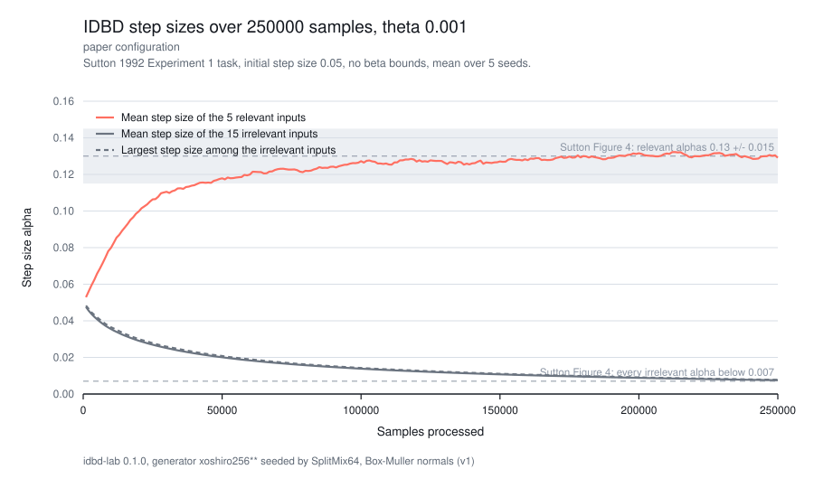
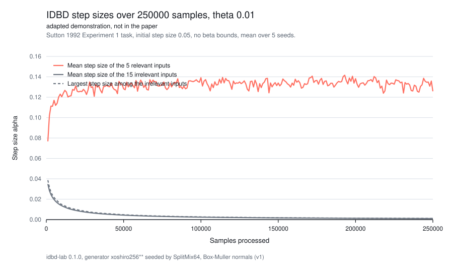
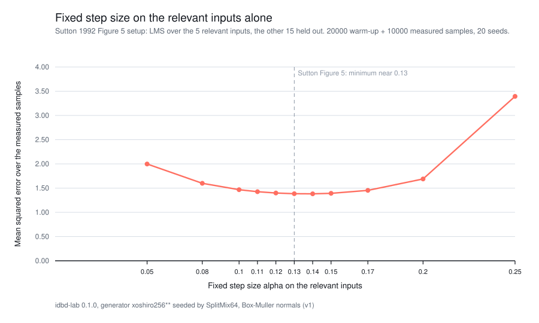

# Sutton 1992, Experiment 2: step-size separation

Scenario E02. Produced by `cargo run --release -p idbd-lab --bin sutton1992-exp2`.

idbd-lab 0.1.0, generator xoshiro256** seeded by SplitMix64, Box-Muller normals (v1)

## Protocol

- Task: the Sutton (1992) Experiment 1 tracking task. 20 independent standard normal inputs, the first 5 relevant with coefficients +1 or -1 drawn from the seed. One of the five, chosen uniformly at random, flips sign before samples 21, 41, 61 and so on, every 20 samples. The same five stay relevant for the whole run.
- Each run processes 250000 samples with initial step size 0.05 on every input and beta bounds disabled (`Bounds::none()`).
- Step sizes are recorded every 1000 samples and at the final sample.
- Seeds 1..=5. A seed fixes the inputs, the initial signs and which coefficient flips at each boundary.

## Paper configuration, theta 0.001

Final step sizes after 250000 samples:

| seed | relevant mean +/- SE | relevant range | irrelevant mean +/- SE | largest irrelevant | failure |
| --- | --- | --- | --- | --- | --- |
| 1 | 0.1297 +/- 0.001557 | 0.126 to 0.1344 | 0.00759 +/- 2.063e-5 | 0.00773 | none |
| 2 | 0.1299 +/- 0.003237 | 0.120 to 0.1403 | 0.007518 +/- 3.253e-5 | 0.007734 | none |
| 3 | 0.1317 +/- 0.002899 | 0.1237 to 0.1406 | 0.007529 +/- 3.047e-5 | 0.007761 | none |
| 4 | 0.1291 +/- 0.001703 | 0.1245 to 0.1338 | 0.007559 +/- 3.200e-5 | 0.007828 | none |
| 5 | 0.1252 +/- 0.00204 | 0.1195 to 0.1301 | 0.007529 +/- 3.256e-5 | 0.007804 | none |

### Against Figure 4

Sutton reports that after 250,000 samples the fifteen irrelevant step sizes were all below 0.007 and the five relevant ones were 0.13 +/- 0.015.

- Measured relevant step size, averaged within a run and then across the 5 seeds: 0.1291 +/- 0.001062. That is inside the reported interval.
- Largest irrelevant step size seen in any seed: 0.007828. That is above the reported bound.

The shaded band in the plot marks the reported interval and the dashed lines mark the two reported values. The same protocol differences as Experiment 1 apply: the paper leaves its generator, seed and initial signs unstated, and it reports one run where this records 5.

## Adapted demonstration, theta 0.01

This configuration is not in the paper. It raises the meta step size by a factor of ten to show faster separation, and its numbers must not be read as a reproduction of anything Sutton reports.

Final step sizes after 250000 samples:

| seed | relevant mean +/- SE | relevant range | irrelevant mean +/- SE | largest irrelevant | failure |
| --- | --- | --- | --- | --- | --- |
| 1 | 0.1405 +/- 0.009795 | 0.1033 to 0.1571 | 0.001065 +/- 1.091e-5 | 0.00114 | none |
| 2 | 0.1389 +/- 0.01015 | 0.1211 to 0.1756 | 0.001048 +/- 1.068e-5 | 0.001109 | none |
| 3 | 0.1292 +/- 0.005779 | 0.1149 to 0.1418 | 0.001071 +/- 1.499e-5 | 0.001181 | none |
| 4 | 0.1135 +/- 0.005935 | 0.09888 to 0.1335 | 0.001048 +/- 1.323e-5 | 0.001131 | none |
| 5 | 0.107 +/- 0.0158 | 0.07151 to 0.1484 | 0.001069 +/- 1.311e-5 | 0.001161 | none |
## Figure 5 comparison: a fixed step size on the relevant inputs

Sutton's Figure 5 sweeps a fixed learning rate for the relevant inputs while the irrelevant ones are held at zero, and reports a minimum near 0.13 +/- 0.01. The run below reproduces that setup directly: LMS over the 5 relevant inputs only, with 20000 warm-up and 10000 measured samples on seeds 1..=20.

| alpha | mean MSE | standard error | failed |
| --- | --- | --- | --- |
| 0.05 | 1.998 | 0.008668 | 0 |
| 0.08 | 1.599 | 0.005556 | 0 |
| 0.1 | 1.467 | 0.004678 | 0 |
| 0.11 | 1.426 | 0.004511 | 0 |
| 0.12 | 1.399 | 0.00453 | 0 |
| 0.13 | 1.385 | 0.004759 | 0 |
| 0.14 | 1.382 | 0.00525 | 0 |
| 0.15 | 1.392 | 0.006082 | 0 |
| 0.17 | 1.453 | 0.009376 | 0 |
| 0.2 | 1.689 | 0.02439 | 0 |
| 0.25 | 3.394 | 0.2722 | 0 |

Lowest measured value on this grid: alpha 0.14, MSE 1.382 +/- 0.00525.

## Files

- `trajectories.csv`: one row per run, seed and checkpoint, with the relevant mean, range and the irrelevant mean and maximum.
- `final-step-sizes.csv`: one row per run, seed and input, with its step size at the end of the run.
- `figure5-sweep.csv`: one row per fixed step size and seed.
- `figure4.svg`, `adapted-demonstration.svg`, `figure5.svg`: the plots above.
